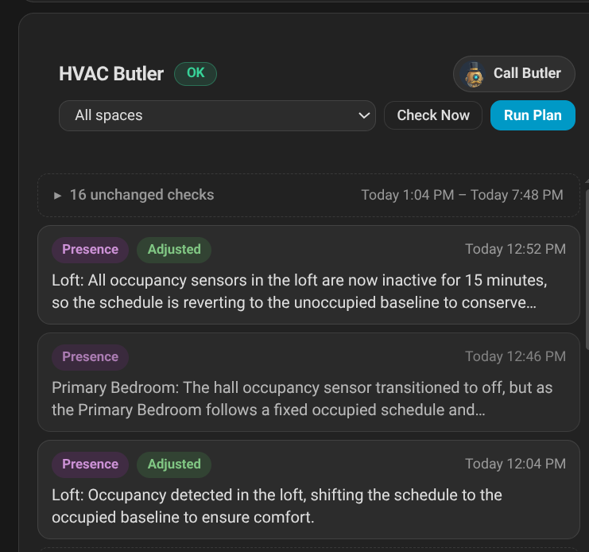
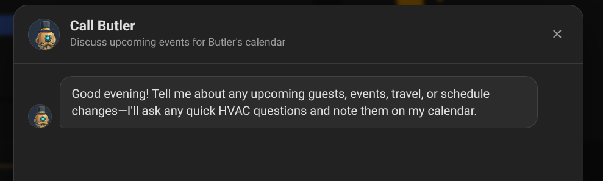
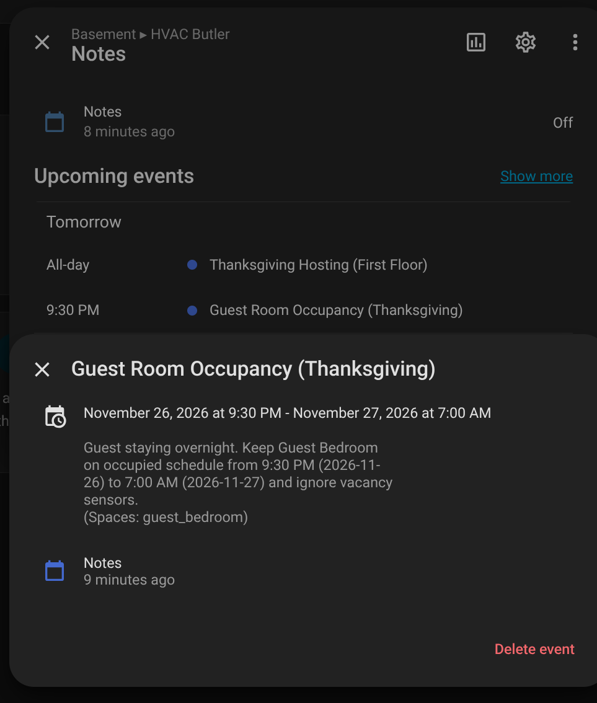

# HVAC Butler

[](https://github.com/dlarrick/hvac-butler/actions/workflows/test.yml)
[](https://github.com/dlarrick/hvac-butler/actions/workflows/validate.yml)
[](https://github.com/dlarrick/hvac-butler/releases)
[](https://github.com/dlarrick/hvac-butler)
[](https://opensource.org/licenses/MIT)

**An attentive AI butler for Home Assistant climate control, providing smart adaptive thermostat schedules with strict non-AI guardrails.**

Static thermostat schedules don't know that a howling windstorm makes 68°F feel drafty, that tomorrow morning's deep freeze needs an earlier warm-up, that nobody is home today because the alarm is armed away, or that someone just walked into a chilly guest room. HVAC Butler brings real-world context into Home Assistant climate control without giving up deterministic safety or local reliability.

## How It Works

1. **Nightly Planning (9:00 PM):** Reviews tomorrow's weather forecast, your occupied/unoccupied baseline routines, Butler's private calendar notes, and persistent notes about your house and rooms (*"south-facing windows"*, *"woodstove in living room"*, *"dogs stay downstairs"*) to craft a tailored schedule for tonight and tomorrow.
2. **Attentive Intraday Adjustments:** Stays quiet during normal operation and wakes up only when reality changes — alarm armed away/disarmed, sustained presence/vacancy in a room, or a timed Butler calendar event starting/ending — updating the remaining day's schedule and (when appropriate) issuing a temporary decaying comfort boost.
3. **Call Butler & Private Calendar (`calendar.hvac_butler_notes`):** Click **Call Butler** on the dashboard card to have a quick conversation about upcoming guests, hosting, travel, or schedule changes. The Butler asks any brief HVAC clarifying questions it needs and writes auto-expiring notes to its own standard Home Assistant calendar (`calendar.hvac_butler_notes`, visible in HA's native Calendar view with delete-only recovery).
4. **Native Home Assistant Schedules & Shadow Mode:** Writes directly to native Home Assistant `schedule.*` helpers (`schedule.<space>_butler`) so you can inspect the Butler's proposed plan alongside your existing schedules before ever handing over control.
5. **Trust, but Verify:** Every AI proposal passes through deterministic Python guardrails that enforce hard temperature bounds, deadband separation, maximum deviation limits from your baselines, and automatic fallback to your baseline schedule if anything looks off.

## Dashboard Card

HVAC Butler automatically bundles and registers the **`custom:hvac-butler-card`** Lovelace card (no separate Marketplace frontend install or manual resource entry required). Add it from the Home Assistant card picker (under **By card**, or **By entity** on any HVAC Butler sensor) or with minimal YAML:

```yaml
type: custom:hvac-butler-card
days: 2  # optional (1–7 days, default: 2)
```



- **Call Butler:** Tap **Call Butler** in the header to brief the Butler on upcoming events (e.g., *"Tomorrow is Thanksgiving, 8 people, heavy cooking, mother-in-law staying in the guest room"*). Click **Done** to commit the Butler's notes to `calendar.hvac_butler_notes` (and trigger an immediate re-evaluation if active today/tonight), or **Cancel** to discard.





- **Activity Timeline (All Spaces or Per-Space):** Switch between **All spaces** and any individual space from the header dropdown to browse up to 7 days of Butler decisions in a compact, scrollable timeline (newest first), or click **Check Now** / **Run Plan** to trigger an on-demand intraday check or macro-plan.
- **Pinned Plan Bar & Noise Reduction:** A 1-line **Plan** call-out stays pinned above the scroll area for quick access while every `Plan` entry also remains in its true chronological spot in the timeline; consecutive unchanged intraday checks collapse into a single expandable row.
- **Deterministic Trigger Badges:** Each entry's primary badge (`Plan`, `Presence`, `Arm/Disarm`, `Calendar`, `Manual Check`) is 100% deterministic and indicates **what triggered the evaluation**, not an AI result. Secondary badges (`Adjusted`, `Comfort Boost`, `Fallback`) reflect deterministic actions actually taken.
- **Full-Context Detail Modal:** Click any row to read the AI's verbatim commentary for the selected space (with before/after schedule diffs), plus the rest of the home's commentary from that same run and collapsible technical details.

## Installation

### Via Marketplace / HACS (Recommended)

[](https://my.home-assistant.io/redirect/hacs_repository/?owner=dlarrick&repository=hvac-butler&category=integration)

Or manually add as a Custom Repository in Marketplace (formerly HACS):
1. Ensure [Marketplace (HACS)](https://hacs.xyz/) is installed in Home Assistant.
2. In Marketplace, navigate to **Integrations** > **Custom repositories** (top-right menu).
3. Add `https://github.com/dlarrick/hvac-butler` with category **Integration**.
4. Download and restart Home Assistant.

### Manual Installation

Copy the `custom_components/hvac_butler` directory into your Home Assistant `<config_dir>/custom_components/` directory and restart Home Assistant.

## Configuration

HVAC Butler is configured entirely through the Home Assistant UI (**Settings → Devices & Services → Add Integration → HVAC Butler**):

1. **Initial Setup:** Select your Home Assistant `ai_task` entity, `weather` entity, and optional `alarm_control_panel` entity. If [HVAC Fusion](https://github.com/dlarrick/hvac-fusion) is installed, existing spaces are pre-populated automatically.
2. **Global Settings & Safety Bounds (Configure):** Add global house notes and set deterministic temperature limits (`min_heat_temp`, `max_heat_temp`, `min_cool_temp`, `max_cool_temp`, and `max_ai_delta_f`).
3. **Manage Spaces (Configure):** For each space, link its `climate.*` entity, occupied baseline `schedule.*`, optional unoccupied `schedule.*`, default mode, optional presence sensors, and room-specific notes (noting presence sensor types such as PIR motion, mmWave radar, or bed sensors helps the AI interpret occupancy behavior).

HVAC Butler automatically creates and maintains a native `schedule.<space>_butler` helper for each space (and registers a `"Butler"` preset on HVAC Fusion spaces). You can run in **shadow mode** for as long as you like by leaving your thermostats on your existing preset while reviewing Butler's proposed schedules and activity card.

## Compatibility

- **Bring Your Own AI Provider:** Uses Home Assistant's native `ai_task` integration (Gemini, OpenAI, Anthropic, Ollama, etc.) — no separate API keys to manage. *(Note: some free-tier cloud API plans—such as Google Gemini's free tier—may intermittently return `503` overload/rate-limit errors instead of `429`; a billed pay-as-you-go API key or local Ollama model provides the most reliable experience.)*
- **Works Standalone:** Compatible with standard Home Assistant `climate.*` entities and native `schedule.*` helpers.

### Better Together with [HVAC Fusion](https://github.com/dlarrick/hvac-fusion)

HVAC Butler works standalone with any Home Assistant climate entity, and pairs seamlessly with **[HVAC Fusion](https://github.com/dlarrick/hvac-fusion)** if you want:

- **Dual-Fuel & Multi-Source Optimization:** Automatically choose between heat pumps, mini-splits, boilers, or furnaces based on real-time COP and utility tariffs.
- **Visual Schedule Viewer & Editor:** Interactive 7-day weekly schedule editor (`custom:schedule-preset-card`) and 24-hour space timeline card (`custom:hvac-fusion-status-card`) for inspecting and editing your baseline and Butler schedules.
- **COP & AFUE-Based Cost Estimates:** Real-time hourly heating cost and baseline savings estimates modeled from your space envelope, equipment profiles, and fuel/electric rates.
- **More Automatic Butler Setup & Control:** HVAC Butler automatically discovers your HVAC Fusion spaces during setup, registers the `"Butler"` preset for you, respects schedule edit locks, and dispatches decaying temporary comfort boosts when someone enters a chilly or warm room.

## Planned Enhancements

- **Deterministic Non-AI Heuristic Fallback:** Graceful local degradation during extended cloud LLM outages or rate limits.
- **Proactive External Calendar Clarification:** Scan household `calendar.*` entities and ask concise clarifying questions when an event is ambiguous (*"Maui trip — housesitter? Dogs home or boarded?"* or *"Wednesday Sync — Zoom from Home Office, or away?"*), saving answers as reusable rules.
- **Transparent Habit & Proximity Learning:** Surface learned occupancy routines and override patterns as plain-English, inspectable notes alongside your schedule, and anticipate arrivals via proximity zones.
- **Cooling-Season Comfort & Passive-Cooling Advisories:** Factor in interior humidity/dewpoint and suggest free overnight cooling (*"Tonight is a great night to air out the house"*).
- **Empirical Thermal Awareness & Envelope Calibration:** Learn per-space coast-down and recovery behavior from Home Assistant history to scale setbacks with weather severity and propose `hvac-fusion` calibration refinements.
